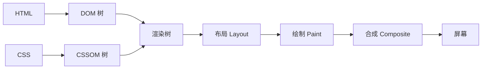
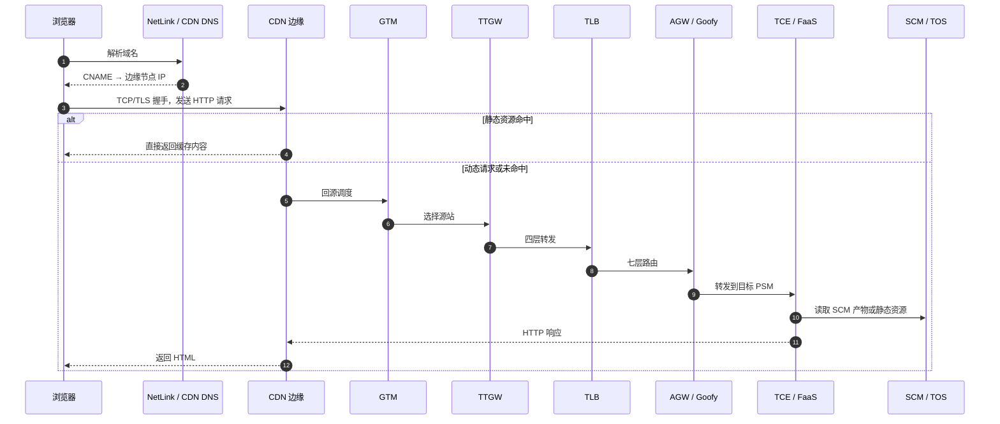

在浏览器地址栏输入 URL 到页面展示，背后会串起 DNS、TCP、TLS、HTTP、ARP、数据封装与浏览器渲染等多个环节。这里简单介绍一下一次请求的完整过程，以及这个链路中的请求是怎么经过字节基建的。

## 一次请求的完整过程

简单来说就是分为以下几步

1. **浏览器解析 URL 并检查缓存**：浏览器解析 URL 的各组成部分，并检查 HTTP 缓存（强缓存、协商缓存）是否已有该资源的有效副本。
2. **DNS 解析**：浏览器通过 DNS 协议，获取域名对应的 IP 地址。
3. **建立传输连接**：HTTP/1.1 和 HTTP/2 通常先通过 TCP 三次握手建立连接；HTTP/3 则建立基于 UDP 的 QUIC 连接。
4. **建立安全通道（HTTPS）**：HTTP/1.1 和 HTTP/2 通常在 TCP 建连后进行 TLS 握手；HTTP/3 在 QUIC 建连过程中集成 TLS 1.3。
5. **发送 HTTP 请求**：浏览器在连接上向服务器发送 HTTP 请求报文，请求获取网页内容。
6. **服务器处理并返回响应**：服务器收到请求后处理并返回 HTTP 响应报文。
7. **浏览器解析与渲染**：浏览器解析 HTML、CSS，执行 JavaScript，并加载页面中引用的其他资源。
8. **连接管理**：页面加载完成后，连接根据 keep-alive 策略复用或关闭。

网络通信模型可以用下图来表示。访问网页的过程就是数据从应用层逐层向下封装，经物理网络传输到对端，再逐层向上解封装的过程。


### 第一步：解析 URL 与缓存检查

打开浏览器，在地址栏输入 URL 并回车。浏览器做的第一件事不是发请求，而是解析 URL 并检查是否可以直接使用本地缓存。

#### URL

URL（Uniform Resource Locator，统一资源定位符）是互联网上资源的唯一地址。网络上的每个可访问资源都对应一个 URL，理论上文件和 URL 一一对应。实际上也有例外，比如重定向或 CDN 场景下，多个 URL 可能指向同一份资源。

一个完整的 URL 由以下几部分组成：


- **协议（Scheme）**：URL 的前缀表示采用的协议，最常见的是 `http` 和 `https`，也有文件传输的 `ftp` 等。
- **域名（Host）**：访问目标的通用名，也可以直接使用 IP 地址。域名本质上是 IP 地址的可读版本。
- **端口（Port）**：紧跟域名后面，用冒号隔开。HTTP 默认 80，HTTPS 默认 443，如果使用默认端口可以省略。
- **资源路径（Path）**：从第一个 `/` 开始，表示服务器上的资源位置。早期设计中路径对应服务器上的物理文件，现在通常是后端路由映射的虚拟路径。
- **查询参数（Query）**：`?` 之后的部分，采用 `key=value` 键值对形式，多个参数用 `&` 隔开。服务器解析请求时会提取这些参数。
- **锚点（Fragment）**：`#` 之后的部分，用于定位到页面内的某个位置。锚点不会作为请求的一部分发送给服务端，仅由浏览器本地处理。

#### 浏览器缓存检查

解析完 URL 之后，浏览器会先检查 HTTP 缓存，看是否已经有该资源的有效副本：

- **强缓存**：检查 `Cache-Control`（如 `max-age`）或 `Expires` 头，判断缓存是否仍在有效期内。如果有效，直接使用缓存，跳过后续所有网络请求。
- **协商缓存**：强缓存未命中时，浏览器向服务器发送验证请求（携带 `If-Modified-Since` 或 `If-None-Match`），服务器判断资源是否变化。如果未变化，返回 `304 Not Modified`，浏览器继续使用本地缓存；如果已变化，返回 `200 OK` 和新资源。

HTTP 缓存命中时，整个访问过程在此结束，无需发起网络请求。真实系统里，缓存通常不止一层：

- **浏览器缓存**：用户设备上的 HTTP 缓存，避免重复请求。
- **CDN 边缘缓存**：离用户最近的节点缓存静态资源，命中时直接返回。
- **源站缓存**：源站前的缓存组件，减少回源到业务服务。
- **服务内缓存**：进程内缓存或 Redis 等，减少数据库和下游压力。

后面会看到，CDN 的命中与回源、源站缓存，都是这条缓存链路的延伸。

#### 域名解析准备

如果 HTTP 缓存未命中，浏览器需要向服务器发起网络请求，首先要拿到域名对应的 IP 地址。在正式发起 DNS 查询之前，浏览器还会依次检查：

- **浏览器 DNS 缓存**：浏览器自身维护了一份 DNS 缓存，先看有没有该域名的记录。
- **操作系统 DNS 缓存**：浏览器缓存未命中时，查询操作系统的 DNS 缓存。
- **hosts 文件**：操作系统会检查本地 hosts 文件，看是否有域名到 IP 地址的直接映射。如果有，直接使用该 IP 地址，跳过 DNS 解析。

如果以上都没有命中，浏览器就需要发起完整的 DNS 查询。

### 第二步：DNS 解析

DNS（Domain Name System，域名系统）要解决的是域名和 IP 地址的映射问题。域名只是便于人类记忆的名字，网络通信真正需要的是 IP 地址。

#### DNS 解析过程

以访问 `www.example.com` 为例，一次典型的 DNS 查询会经过：

1. **浏览器 DNS 缓存**：浏览器先看自己有没有该域名的记录且未过期。
2. **操作系统 DNS 缓存**：浏览器缓存未命中时，向操作系统发起 DNS 查询请求。
3. **本地 DNS 服务器**：操作系统配置的本地 DNS 服务器（通常由 ISP 提供，或使用公共 DNS）。本地 DNS 如果有缓存且未过期，直接返回结果。
4. **根 DNS 服务器**：本地 DNS 缓存未命中时，先问根 DNS 服务器，拿到 `.com` 顶级域服务器的地址。
5. **顶级域 DNS 服务器**：向顶级域服务器询问 `example.com` 的权威 DNS 服务器地址。
6. **权威 DNS 服务器**：向权威 DNS 服务器询问 `www.example.com` 的 A/AAAA 记录，拿到最终 IP。
7. **返回结果并缓存**：本地 DNS 把结果返回给客户端，同时在本地缓存一份，供后续查询使用。


实际场景中，本地 DNS 往往已经缓存了大量 TLD 地址，多数查询不需要从根服务器开始，跳过根服务器直接查 TLD 的情况非常普遍。

常见的 DNS 记录类型有：

- **A**：域名到 IPv4 地址的映射。
- **AAAA**：域名到 IPv6 地址的映射。
- **CNAME**：域名到另一个域名的别名，CDN 接入经常使用。
- **NS**：指定域名的权威 DNS 服务器。
- **TXT**：文本记录，常用于域名验证、SPF 等。
- **MX**：邮件服务器记录。

CDN 接入通常通过 CNAME 完成：`www.example.com` 先 CNAME 到 CDN 提供的域名，再由 CDN 的权威 DNS 根据用户地理位置、网络状况、节点负载等因素返回一个合适的边缘节点 IP。这个过程可能发生多轮 CNAME 解析。

此外，域名解析记录有 TTL，修改后需要等待全球 DNS 缓存同步，也就是常说的 **DNS 传播**。传播时间取决于 TTL，通常可能需要 24–48 小时，因此新域名刚配置完还需要等解析传播完才能访问。

DNS 问题可以用 `dig` 或 `dnschecker.org` 这类工具进一步确认

```bash
# 查看域名解析结果
dig www.example.com

# 指定 DNS 服务器查询
dig @8.8.8.8 www.example.com

# 只关心 CNAME 链
dig +short www.example.com
```

### 第三步：建立传输连接

拿到目标服务器的 IP 地址后，浏览器需要与服务器建立传输连接。下面是 HTTP/1.1 和 HTTP/2 常用的 TCP 连接；如果协商使用 HTTP/3，则会改为建立 QUIC 连接（QUIC 构建在 UDP 之上）

#### TCP 报文

TCP 报文头部的格式：


- **源端口号和目标端口号**：确定数据发送地址与对象
- **包序号**，这个是为了解决包乱序的问题。
- **确认号**，目的是确认发出去对方是否有收到。如果没有收到就应该重新发送，直到送达，这个是为了解决丢包的问题。
- **状态位**，例如 SYN 是发起一个连接，ACK 是回复，RST 是重新连接，FIN 是结束连接等。TCP 是面向连接的，因而双方要维护连接的状态，这些带状态位的包的发送，会引起双方的状态变更。
- **窗口大小**，TCP 要做流量控制，通信双方各声明一个窗口（缓存大小），标识自己当前能够的处理能力。

除了做流量控制以外，TCP还会做拥塞控制，控制发送的速度。

#### TCP 三次握手

TCP 三次握手的目的是同步双方的初始序列号，并确认双方的收发路径是可用的。


- **第一次握手（SYN）**：客户端发送 SYN 报文段，携带自己的初始序列号 `seq=x`，进入 `SYN_SENT` 状态。
- **第二次握手（SYN+ACK）**：服务端收到后回复 SYN+ACK，携带自己的初始序列号 `seq=y`，确认号 `ack=x+1`，进入 `SYN_RCVD` 状态。
- **第三次握手（ACK）**：客户端收到后发送 ACK，确认号 `ack=y+1`，双方进入 `ESTABLISHED` 状态，连接建立完成。

TCP使用三次握手是为了确保双方可靠建立连接、同步序列号，并防止历史连接造成混乱。

#### 如果是 HTTPS：TLS 握手

如果使用基于 TCP 的 HTTPS，则在 TCP 连接建立之后还要进行 TLS 握手。HTTP/3 则在 QUIC 建连过程中集成 TLS 1.3。TLS 的核心目标是三个：加密（防窃听）、认证（防冒充）、完整性校验（防篡改）。

以 TLS 1.2 的 RSA 密钥交换为例：

1. **Client Hello**：客户端发送支持的 TLS 版本、加密套件列表和一个随机数。
2. **Server Hello**：服务端从中选择一个加密套件，返回自己的证书和另一个随机数。
3. **密钥交换**：客户端验证服务端证书的合法性，然后生成预主密钥（Pre-Master Secret），用服务端公钥加密后发送给服务端。双方根据预主密钥和之前交换的两个随机数，计算出对称加密的会话密钥。
4. **完成**：双方用会话密钥加密通信，握手结束。

TLS 握手完成后，后续的 HTTP 请求和响应都会使用协商好的对称密钥进行加密传输。HTTPS 的安全性来自 TLS 层，而不是 HTTP 协议本身的改变。

### 第四步：发送 HTTP 请求

TCP 连接（以及可能的 TLS 通道）建立好之后，浏览器就可以发送 HTTP 请求了。

#### HTTP 请求报文结构

一个典型的 HTTP/1.1 请求报文如下：

```http
GET /index.html HTTP/1.1
Host: www.example.com
User-Agent: Mozilla/5.0 (Macintosh; Intel Mac OS X 10_15_7)
Accept: text/html,application/xhtml+xml
Accept-Encoding: gzip, deflate, br
Accept-Language: zh-CN,zh;q=0.9,en;q=0.8
Connection: keep-alive
Cookie: session_id=abc123
```

各部分含义：

- **请求行**：`GET /index.html HTTP/1.1`，包含请求方法（GET）、资源路径（`/index.html`）、协议版本（HTTP/1.1）。
- **Host 头**：指定目标主机名。这是 HTTP/1.1 的强制要求，因为同一台服务器（同一个 IP）可能通过虚拟主机托管多个网站。
- **其他请求头**：`User-Agent`（客户端信息）、`Accept`（可接受的响应类型）、`Accept-Encoding`（支持的压缩方式）、`Cookie`（携带的状态信息）等。

#### 服务器处理请求

服务器收到请求后，经过一系列处理生成响应：

- **接收请求**：Web 服务器（如 Nginx、Tomcat）接收并解析 HTTP 请求报文。
- **路由分发**：根据 URL 路径将请求路由到对应的后端处理逻辑。
- **业务处理**：执行具体的业务逻辑，可能涉及数据库查询、缓存读取、调用其他服务等。
- **构建响应**：将处理结果封装成 HTTP 响应报文。

#### HTTP 响应报文结构

一个典型的 HTTP 响应报文如下：

```http
HTTP/1.1 200 OK
Content-Type: text/html; charset=UTF-8
Content-Encoding: gzip
Content-Length: 1256
Cache-Control: max-age=3600
Set-Cookie: session_id=xyz789; Path=/
```

各部分含义：

- **状态行**：`HTTP/1.1 200 OK`，包含协议版本、状态码和状态描述。
- **响应头**：`Content-Type`（响应体类型）、`Content-Encoding`（压缩方式）、`Cache-Control`（缓存策略）、`Set-Cookie`（设置 Cookie）等。
- **响应体**：请求的实际内容，如 HTML 文档、JSON 数据、图片二进制数据等。

常见状态码：

| 状态码 | 类别       | 常见示例                                                        |
| ------ | ---------- | --------------------------------------------------------------- |
| 2xx    | 成功       | 200 OK、206 Partial Content                                     |
| 3xx    | 重定向     | 301 永久重定向、302 临时重定向、304 未修改                      |
| 4xx    | 客户端错误 | 400 Bad Request、403 Forbidden、404 Not Found                   |
| 5xx    | 服务端错误 | 500 Internal Server Error、502 Bad Gateway、504 Gateway Timeout |

### 第五步：数据包的封装与转发

HTTP 请求从浏览器发出后，数据需要经过协议栈的逐层封装，在物理网络上一跳一跳地转发到目的地。

#### 数据封装过程

应用层的 HTTP 报文，经过传输层、网络层、链路层的逐层封装，最终变成能在物理介质上传输的比特流：


每一层只关心自己要添加的头部信息，并使用下层提供的服务来传输数据：

- **传输层（TCP）**：添加源端口和目的端口，用序列号和确认号保证可靠传输。
- **网络层（IP）**：添加源 IP 和目的 IP，负责寻址和路由，决定数据包从源到目的经过的路径。
- **链路层**：添加源 MAC 和目的 MAC 地址，负责在相邻节点之间传输数据帧。
- **物理层**：把帧转换成电信号、光信号或无线电波。

#### 网络层的路由转发

数据包从源主机到目的主机，通常需要经过多个路由器中转。网络层的核心功能就是路由与转发：

- **路由**：确定分组从源到目的经过的路径，由 OSPF、BGP 等路由协议计算。
- **转发**：将分组从路由器的输入端口转移到合适的输出端口。

每个路由器维护一张路由表，根据目的 IP 地址查表决定下一跳。数据包在网络中每一站只看下一站发到哪里，不用关心全程路径。

#### ARP 协议：从 IP 地址到 MAC 地址

数据帧在链路层传输时，需要知道下一跳设备的 MAC 地址，而不能只用 IP 地址。ARP（Address Resolution Protocol，地址解析协议）就是解决“已知 IP 地址，如何获取对应 MAC 地址”的问题。


ARP 的工作方式是广播问询、单播响应：

1. 主机先查本地 ARP 缓存表，看是否已有目标 IP 对应的 MAC 地址。
2. 缓存未命中时，在局域网内广播一个 ARP 请求：“谁的 IP 是 xxx？请告诉我你的 MAC 地址。”
3. 目标设备（或路由器接口）收到后，以单播方式回复自己的 MAC 地址。
4. 请求方收到响应后，将 IP-MAC 映射存入 ARP 缓存表，后续通信直接使用。

如果目标主机不在同一子网，主机不需要知道最终目标的 MAC 地址，只需要知道本地网关（路由器）的 MAC 地址即可。数据包先发给网关，网关再逐跳转发到目标网络。

#### 网络地址转换（NAT）

在大多数家庭和企业网络中，内网主机使用的是私有 IP 地址（如 `192.168.x.x`），不能直接在公网上路由。NAT（Network Address Translation）协议负责在内网和公网之间转换 IP 地址。

当内网主机发送数据包到公网时，NAT 设备（通常是路由器）会将源 IP 地址从私有地址替换为公网地址，并记录端口映射关系。响应数据包返回时，NAT 再根据映射表把目的地址转换回内网主机的私有地址。

### 第六步：浏览器解析与渲染

服务器返回 HTML 响应后，浏览器的工作才真正开始。浏览器需要解析 HTML、构建 DOM 树、加载子资源、计算样式、布局并最终渲染到屏幕上。

#### HTML 解析与 DOM 构建

浏览器拿到 HTML 文档后，从上到下逐行解析：



1. **构建 DOM 树**：解析 HTML 标签，生成文档对象模型（DOM）树，表示页面的结构。
2. **构建 CSSOM 树**：遇到 `<link>` 引用的 CSS 文件或 `<style>` 标签时，下载并解析 CSS，生成 CSS 对象模型（CSSOM）树，表示页面的样式规则。
3. **构建渲染树**：将 DOM 树和 CSSOM 树合并，生成渲染树。渲染树只包含需要显示的节点及其样式信息（`display: none` 的元素不会出现在渲染树中）。
4. **布局（Layout）**：计算渲染树中每个节点的位置和大小。
5. **绘制（Paint）**：将布局后的渲染树转换为屏幕上的像素。
6. **合成（Composite）**：将不同图层合成最终画面显示在屏幕上。

#### 子资源加载

HTML 文档通常会引用大量外部资源：

- **CSS 文件**：普通阻塞样式表会阻塞渲染，浏览器通常会等 CSS 加载并解析完成后才进行布局和绘制，因为 CSS 可能改变元素的布局。通过 `media` 属性、动态加载或 `preload` 等方式可以改变这一行为。
- **JavaScript 文件**：默认会阻塞 HTML 解析，因为 JavaScript 可能修改 DOM。可以通过 `async` 或 `defer` 属性改变加载行为。
- **图片、字体等**：不会阻塞 HTML 解析，但需要在加载完成后才能显示。

这些子资源的加载会触发额外的 HTTP 请求。如果使用 HTTP/1.1，浏览器通常会对同一域名维护最多 6 个左右的并发 TCP 连接来并行下载资源。HTTP/2 的多路复用机制则允许在同一个 TCP 连接上并行传输多个资源。

#### JavaScript 执行

JavaScript 的执行会阻塞 HTML 解析。浏览器遇到 `<script>` 标签时，会暂停 DOM 构建，先下载并执行脚本。如果脚本中有 DOM 操作，可能会触发 DOM 重构和页面重排（Reflow）或重绘（Repaint）。

现代前端开发中常用的优化手段包括：

- 将 `<script>` 放在 `<body>` 底部或使用 `defer` 属性，避免阻塞 DOM 解析。
- 使用 `async` 属性异步加载不影响 DOM 的脚本。
- 通过 CDN 加速静态资源加载。
- 利用浏览器缓存减少重复请求。

#### CSR 与 SSR

页面渲染还分 CSR 和 SSR：

- **CSR（客户端渲染）**：服务端先返回一个 HTML 壳，浏览器下载并执行 JS，JS 再请求数据、生成 DOM 并渲染页面。
- **SSR（服务端渲染）**：服务端直接返回带首屏内容的 HTML，浏览器拿到后可以先展示，再加载 JS 完成 hydration，让页面变得可交互。

两者不是互斥的。很多项目会根据页面类型混合使用：首屏要求高的页面走 SSR，交互复杂的页面走 CSR。

### 第七步：连接管理

页面和资源加载完成后，连接通常不会立刻断开，如何管理连接取决于 HTTP 版本和配置。下面的 HTTP/1.0、HTTP/1.1 和 HTTP/2 主要讨论 TCP 连接；HTTP/3 管理的是 QUIC 连接和流。

#### HTTP/1.0 短连接

HTTP/1.0 默认使用短连接：每次请求-响应完成后就关闭 TCP 连接。如果页面引用了 10 个外部资源，浏览器需要建立 10 次独立的 TCP 连接，每次都要经历三次握手和四次挥手，大量时间花在连接的建立和释放上。

#### HTTP/1.1 长连接（Keep-Alive）

HTTP/1.1 默认使用长连接（`Connection: keep-alive`）。一个 TCP 连接建立后可以连续发送多个请求和接收多个响应，不需要每次都重新握手。这样页面中的 CSS、JS、图片等子资源可以复用同一个 TCP 连接来加载。

长连接不是永久的。服务器通常配置了空闲超时时间，如果在超时时间内没有新的请求，服务器才会主动关闭连接。

#### HTTP/2 多路复用

HTTP/2 在长连接的基础上引入了多路复用。同一个 TCP 连接上可以同时传输多个请求和响应，数据被拆分成更小的帧并通过流（Stream）标识来区分归属。这解决了 HTTP/1.1 在应用层面的队头阻塞问题——前面的慢请求不会挡住后面的请求。

需要注意的是，HTTP/2 仍然基于 TCP，当 TCP 层发生丢包时，同一连接上的所有流都会受影响（TCP 层队头阻塞）。HTTP/3 基于 QUIC 协议（UDP），才进一步缓解了这个问题。

#### 连接关闭

当数据传送完毕，需要断开 tcp 连接，此时发起 tcp 四次挥手：

- 发起方向被动方发送报文，Fin、Ack、Seq，表示已经没有数据传输了。并进入 FIN_WAIT_1 状态。(第一次挥手：由浏览器发起的，发送给服务器，我请求报文发送完了，你准备关闭吧)
- 被动方发送报文，Ack、Seq，表示同意关闭请求。此时主机发起方进入 FIN_WAIT_2 状态。(第二次挥手：由服务器发起的，告诉浏览器，我请求报文接受完了，我准备关闭了，你也准备吧)
- 被动方向发起方发送报文段，Fin、Ack、Seq，请求关闭连接。并进入 LAST_ACK 状态。(第三次挥手：由服务器发起，告诉浏览器，我响应报文发送完了，你准备关闭吧)
- 发起方向被动方发送报文段，Ack、Seq。然后进入等待 TIME_WAIT 状态。被动方收到发起方的报文段以后关闭连接。发起方等待一定时间未收到回复，则正常关闭。(第四次挥手：由浏览器发起，告诉服务器，我响应报文接受完了，我准备关闭了，你也准备吧)


`TIME_WAIT` 状态的存在是为了确保最后的 ACK 能到达对端，同时让网络中残留的旧报文消散，避免干扰后续新连接。`CLOSE_WAIT` 堆积通常意味着应用没有正确关闭连接。

至此一次请求的通用过程就讲完了：解析 URL 和缓存 → DNS → TCP/TLS → HTTP → 数据封装与转发 → 浏览器渲染 → 连接管理。这也就是从url到渲染的通用流程。

## 字节跳动的接入与运行体系

真实系统里，请求不会从浏览器直接打到源站，中间还有一层完整的接入与运行体系，这里以我前司字节跳动基建为例展开。

### 2.1 全景：一条请求经过哪些平台

先给出一张带平台角色的链路图：



- **NetLink**：一站式流量接入中台，负责域名管理、DNS 解析、四/七层负载均衡（TTGW/TLB）、七层动态加速（DCDN）、正向代理、云负载均衡、长连接（Frontier）等。
- **CDN / Apollo / KFC / ImageX / VOD**：CDN 负责边缘缓存与加速；Apollo 负责回源调度、鉴权、URL 改写和限流；KFC 负责源站缓存和鉴权；ImageX 负责图片处理与分发；VOD 负责视频点播。
- **GTM**：全局流量管理，负责多源站、多集群的权重和地域调度。
- **TTGW / TLB**：TTGW 是四层负载均衡，TLB 是七层负载均衡（基于 NGINX）。
- **AGW / Goofy**：AGW 负责请求/响应改写、灰度、路由和限流；Goofy 负责前端项目的流量频道匹配。
- **TCE / FaaS**：TCE 是基于 K8s 的容器云；FaaS 是函数即服务，适合轻量、弹性伸缩的场景。
- **ByteMesh / Neptune / Consul**：ByteMesh 是 Service Mesh 实现，Neptune 是流量治理平台，Consul/ByteSD 提供服务发现与注册。
- **SCM / TOS**：SCM 管理构建产物；TOS 是对象存储，托管静态资源。

### 2.2 DNS 与接入：NetLink、CDN DNS

在这套接入体系里，域名和解析通常由 **NetLink** 统一管理。NetLink 是一站式流量接入中台，除了域名管理和 DNS 解析，还提供四/七层负载均衡（TTGW/TLB）、七层动态加速（DCDN）、正向代理、云负载均衡、长连接（Frontier）等能力。

- 新建域名时，NetLink 会自动配置解析，业务一般不需要直接操作 DNS。
- 动态加速场景下，域名通过 CNAME 接入 CDN。
- CDN 自有的权威 DNS 会根据用户地理位置、网络状况、节点负载等因素，选择一个合适的边缘节点 IP。
- 这个过程可能发生多轮 CNAME 解析，比如 `www.example.com` 先 CNAME 到 CDN 域名，再解析到具体的边缘节点。

### 2.3 边缘缓存与回源

DNS 返回 IP 之后，请求并不是直接打到源站，而是先到 CDN 边缘节点。CDN 的核心思想是把内容缓存到离用户更近的地方：命中缓存就直接返回，未命中再回源。

CDN 通常分两类场景：

- **静态加速**：JS、CSS、图片、视频等静态资源，适合长时间缓存。
- **动态加速**：API、HTML 等动态内容，边缘节点通常不缓存响应，而是通过更优的路径回源。

动态域名既然一定要回源，为什么还要接 CDN？主要有两个原因：一是隐藏源站 IP，用户只能看到 CDN 节点，源站不直接暴露；二是 DCDN 会做**接入择优**和**回源择优**，选择更优的第一跳节点和到源站更快的路径。

CDN加速是一种通过全球分布式节点将网站内容缓存并就近分发的网络加速技术，可以显著降低访问延迟、提升网站加载速度并减轻源站压力，字节跳动的 CDN 体系里常见四类加速，区别主要在源站类型，以及边缘节点是否缓存响应：

- **下载加速**：面向构建产物、JS/CSS 等静态文件，源站是 TOS（对象存储）。资源直接存在 TOS，CDN 边缘缓存后可以长期复用。
- **静态 Web 加速**：面向图片，源站是 ImageX（图像处理与分发平台）。ImageX 负责裁剪、压缩、格式转换等处理，内部回源 TOS 取原图。
- **流媒体点播加速**：面向视频，源站是 VOD（视频云点播平台）。VOD 负责转码、封装和播放地址管理，视频文件本身仍然存在 TOS 上。
- **动态加速**：面向后端 API、HTML 等动态内容，源站是业务服务。边缘节点通常不缓存响应，DCDN 通过接入择优和回源择优降低延迟。

回源请求是指当CDN节点未缓存用户请求的资源时，向源站发起请求以获取资源的过程：

- **Apollo**：CDN 的回源调度系统，负责回源鉴权、URL 改写、限流等，决定请求回源时走哪条路径。
- **KFC**：部署在源站前的缓存组件，负责源站缓存和鉴权，减少真正打到业务服务的请求。

### 2.4 多源站调度：GTM

当一个业务有多个源站、多个 TLB 集群，或者需要按地域就近回源时，CDN 回源不能写死一个地址，而要经过 **GTM**。

GTM 负责多源站、多集群的权重调度、按用户地理位置做粗粒度调度、主动健康检查和异常切换。例如，一个业务有多个源站，可以按 80/10/5/5 的权重把回源流量分到不同集群；当某个源站健康检查失败时，GTM 会把流量切到其他源站。BFC 等平台可以对 GTM 的回源策略进行动态调整。

可以这样理解 CDN 和 GTM 的分工：**CDN 决定用户接入哪个边缘节点，GTM 决定边缘节点回源到哪个源站。** GTM 本质上是 DNS 层的调度，CDN 拿到调度结果后，再连接到对应的 TTGW/TLB。

### 2.5 四层与七层负载均衡：TTGW、TLB

经过 GTM 之后，请求通常会先到 **TTGW**，再到 **TLB**。

- **TTGW** 是四层负载均衡，工作在 TCP/UDP 层，职责相对简单，因此能承受更大的流量。它通常挂在 TLB 前面，用来减少公网 IP 消耗。
- **TLB** 是七层负载均衡，基于 NGINX，负责 HTTP/HTTPS 的路由和转发。TLS 通常在接入层完成卸载（可能落在 CDN、边缘 TLS 集群或 TLB，具体取决于接入配置），之后以 HTTP 转发给后端。

TLB 的几个关键概念：

- **集群（Cluster）**：一组 TLB 节点，通常对应一个区域。
- **机房/IDC**：TLB 节点实际部署的机房。
- **路由（Location）**：按域名、路径、Header 等条件匹配的转发规则。
- **后端（Backend）**：命中的服务 PSM、集群、环境和机房。

TLB 集群和服务机房是独立的：一个 TLB 集群可以调度到多个机房，包括跨区域的 extra IDC。例如，一个部署在新加坡区域的 TLB 集群，除了本地机房，还可以调度到马来西亚甚至美国东部的机房。具体支持哪些机房，以集群配置为准。

这也解释了一个常见疑问：为什么新加坡的 TLB 集群能打到美国东部的服务机房？因为 TLB 集群和服务机房不是绑死的关系，调度关系是在 TLB 的机房策略里配置的。

TLB 还会在响应头里留下调试信息：

- **`x-tlb-cluster`**：命中的 TLB 集群。
- **`x-tlb-location`**：命中的 TLB 路由。
- **`x-tlb-idc`**：命中的 TLB 机房。
- **`x-backend`**：命中的后端服务，通常包含 PSM、集群、环境、机房。
- **`x-tlb-backends`**：候选后端列表及调度信息。
- **`x-tlb-rule-trace`**：路由/调度规则的命中轨迹。

这些 Header 在排查“请求到底走到哪一跳”时非常有用。

### 2.6 网关与流量治理

#### AGW：请求与响应的改写层

AGW 是围绕 API 提供流量调度、限流、协议转换、服务治理的 API 网关。它有两种形态：

- **中心化网关**：流量从 TLB 到网关集群，再到业务集群，网关拥有较强的集中调度能力。
- **分布式网关**：网关通过 Mesh 以独立进程部署在业务实例中，流量从 TLB 直接到业务集群，再由网关转发到业务实例。少了一跳，时延更好，也天然与业务隔离。

这里“网关”可以是通过 AGW 平台配置在业务 PSM 上的一个 Golang Handler 插件。它可以做两类事情：

- **请求改写**：把请求分流到不同服务、修改 Header、做灰度。
- **回包改写**：提前返回、重定向、向 HTML 注入变量。

例如，Web 灰度可以在网关内部根据 uid 请求灰度服务，拉取命中的环境，然后把环境信息写入 `x-lvweb-env` 请求头。

#### Goofy 流量频道

Goofy 是前端部署平台。请求到达 Goofy Web Server 后，会根据以下信息匹配流量频道：

- **domain**：对应请求头中的 `Host`。
- **urlPath**：请求 URL 的路径。
- **query、header**：流量频道的匹配条件。

对于 CSR 项目，所有版本的文件在同一个 TOS 桶里，Web Server 根据命中的频道选择不同路径下的文件；对于 SSR 项目，命中的 Web Server 是同一个，但会进入不同的 SSR 环境，常见的是 Header 匹配模式，会创建一个新的 PSM。

### 2.7 服务端运行时：TCE、FaaS、ByteMesh

请求经过接入层和网关之后，最终会落到一个具体的服务实例上。字节跳动的服务运行时主要有两类：TCE 和 FaaS。

TCE 是公司自研的云平台，基于容器技术，底层通过 GödelCloud（K8s）做调度。这里有几个关键概念：

- **PSM**：Product Subsystem Module，服务的唯一标识，格式通常是 `{product}.{subsystem}.{module}`。TLB、FaaS、TOS 等多套服务都用 PSM 作为标识。
- **集群**：一个服务可以有多个集群，用来做流量分流、容灾隔离、配置隔离。
- **机房/区域**：服务实例实际部署的位置，例如新加坡、马来西亚、美国东部等。

服务发现通常有两种路径：

- **Consul/ByteSD**：Agent 注册到 Proxy，Proxy 写入 KV，客户端通过 Proxy 查询实例。
- **ByteMesh**：开启 Mesh 后，由 Sidecar 做服务发现。

FaaS 则把服务函数化，屏蔽了运行环境和机器的概念，支持无状态服务，实例数量可以缩到 0，优点是部署轻、弹性好。

FaaS 的服务发现和 TCE 不太一样：

- 走 Consul 时，TLB 上的 PSM 表面指向 FaaS 服务，实际会通过 `toutiao.bytefaas.gateway` 中转。
- 走 Mesh 时，Sidecar 先向 Gateway 查询函数路由，实例足够就直接转发，实例不足需要冷启动时再转给 Gateway。

两者的取舍可以简单概括为：TCE 适合常驻服务、复杂后端；FaaS 适合轻量逻辑、事件驱动、流量波峰明显的场景。

ByteMesh 是公司内部对 Service Mesh 的自研实现，属于轻量级网络代理，**与应用部署在同一个容器中**，以独立进程代理应用的所有出入口流量。它主要提供服务发现、服务治理、服务安全。Neptune 是基于 ByteMesh 和多种框架的流量治理平台，Mesh 的控制面可以简单理解为 Consul + Neptune + ETCD 的组合。

Mesh 在请求链路中的位置很关键：服务之间的调用不再直接依赖业务代码里的服务发现逻辑，而是由 Sidecar 代理，完成服务发现和治理。

### 2.8 静态资源：TOS、SCM

请求最终要拿到 HTML 和静态资源，这部分由 TOS 和 SCM 承担：

- **TOS**：对象存储，JS/CSS/图片/视频等静态资源的最终存储位置；CDN 回源时从 TOS 读取。
- **SCM**：构建产物管理，存放 HTML 等部署产物；Goofy Web Server 根据命中的流量频道选择对应的 SCM 版本。

### 2.9 总结

在字节跳动的接入与运行体系下，以访问 `www.capcut.com` 为例：

1. **输入 URL**：浏览器解析 URL，检查 HTTP 缓存。
2. **DNS 解析**：NetLink 管理域名，CNAME 接入 CDN；CDN 权威 DNS 根据用户位置、网络状况和节点负载返回边缘节点 IP。
3. **建立连接**：浏览器与 CDN 边缘建立 TCP 连接；HTTPS 继续 TLS 握手；HTTP/3 走 QUIC。
4. **到达边缘**：静态资源命中 CDN 缓存直接返回；动态请求或未命中则回源。
5. **回源调度**：CDN 回源到 GTM，GTM 根据源站健康状态、地域和权重选择源站；请求进入 TTGW。
6. **四层/七层接入**：TTGW 做连接级转发，TLB 按域名、路径、Header 匹配路由，把请求转发到目标 PSM。
7. **网关与治理**：AGW 做请求/响应改写和灰度；Goofy 匹配流量频道；ByteMesh 做服务发现。
8. **服务端处理**：TCE 或 FaaS 执行业务逻辑，可能读取 TOS/SCM 的静态资源，或调用其他服务；响应沿原路返回。
9. **浏览器渲染**：HTML 返回浏览器，子资源走 CDN/TOS/ImageX/VOD；CSR 执行 JS 渲染，SSR 直接展示首屏后 hydration。
10. **连接管理**：浏览器到 CDN、CDN 到源站、TTGW 到 TLB、TLB 到后端、服务到服务，每一段都有自己的连接池和超时策略。

- **应用层**：CDN、GTM、TLB、AGW、Goofy，负责缓存、调度、路由和网关。
- **传输层**：TTGW、TLB，负责连接管理和负载均衡。
- **网络层**：底层网络、NAT 网关，负责寻址、路由和转发。
- **服务治理**：ByteMesh、Neptune、Consul，负责服务发现和治理。
- **运行时**：TCE、FaaS，负责业务进程的承载与弹性。
- **静态资源**：SCM、TOS，负责构建产物和静态资源托管。

至于产物构建发布和灰度，App 内加载和观测排查等相关的链路不在本文展开，后续会补充。

## 参考

- 《计算机网络（第 7 版）》
- 《图解 HTTP》
- [What really happens when you navigate to a URL](https://github.com/alex/what-happens-when)
- [How browsers work](https://web.dev/articles/howbrowserswork)
- [MDN：HTTP 缓存](https://developer.mozilla.org/zh-CN/docs/Web/HTTP/Guides/Caching)
- [RFC 9110：HTTP Semantics](https://www.rfc-editor.org/rfc/rfc9110)
- [RFC 8446：TLS 1.3](https://www.rfc-editor.org/rfc/rfc8446)
- [RFC 9293：TCP](https://www.rfc-editor.org/rfc/rfc9293)
- [RFC 9000：QUIC](https://www.rfc-editor.org/rfc/rfc9000)
